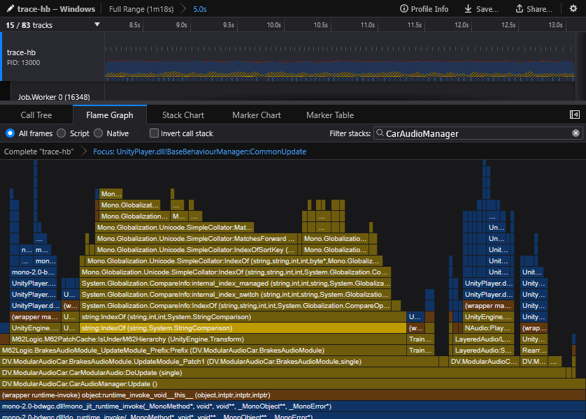

# umprof (Unity Mono Profiler)

This repository contains a collection of tools that will help you take CPU profiles for C# code running in a Unity game.
This is intended for situations where the Unity profiler is not available, most notably in release builds.

## Installation

Download the release ZIP and extract anywhere.
For your convenience, it is recommended to extract the ZIP to the directory where you will capture your profiles.
Make sure to have a few gigabytes of space available, as tracing can generate a lot of data quickly.

## Usage instructions

A detailed guide is available in [USAGE.md](./USAGE.md).

## How it works

This profiler ties into ETW (Event Tracing for Windows) to capture CPU stack traces at regular intervals.
When combined with PDB files, these stack traces provide detailed information about which native methods were executing,
and when.

While this works fine for native code, Unity games tend to run a lot of C# code, which gets JIT-compiled by the Mono
runtime. This means that we cannot rely on PDB files to correlate memory addresses to method names, so if you just run
ETW against a game, you will mostly get garbage.

`umprof` works around this by supplying a patch to the Mono runtime, that lets the JIT compiler write the names and
memory addresses of C# code it compiles to a file. We can then walk each captured stack, and resolve its C# frames by
looking through the JIT map for the right memory address.

This information gets aggregated into a single model, and exported in the Firefox profiler format. Created profiles can
be uploaded to https://profiler.firefox.com to analyse game performance in high detail.
